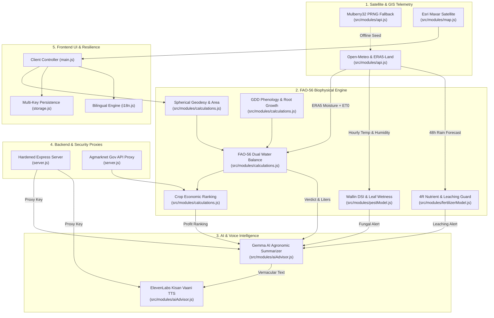

# Graphify Labs — Codebase Architecture & Knowledge Graph Dossier

> **Partner Track:** Best Use of Graphify Labs  
> **Project:** Krishi Mitra (कृषि मित्र) — Field Intelligence Platform  
> **Engine:** Tree-Sitter AST Code Parsing & Dynamic Telemetry Flow Mapping

---

## 1. Executive Summary: Why Krishi Mitra Needed Graphify Labs

Krishi Mitra combines complex domain boundaries:
1. **Satellite Remote Sensing & Earth Observation (EO)**: Copernicus ERA5-Land reanalysis soil moisture ($0–7\text{ cm}$ and $7–28\text{ cm}$) and Open-Meteo atmospheric forecasts.
2. **Biophysical Agronomic Equations**: FAO-56 dual crop coefficient water balance, dynamic root depth $Z_r(t)$, thermal Growing Degree Days (GDD), Wallin Disease Severity Index (DSI), and 4R nutrient leaching risk.
3. **Multi-Model AI Pipelines**: Google DeepMind's open-weight **Gemma** model formulating concise vernacular field summaries, followed by **ElevenLabs** speech synthesis for illiterate or low-literacy farmers.
4. **Resilient Frontend & Hardened Backend**: Esri Maxar GIS map layers, CSP headers, sliding-window rate limiters, and multi-key local storage persistence.

Tracing how a raw satellite coordinate transforms into a millimeter irrigation depth, passes into a Wallin fungal alert, feeds into a Gemma prompt, and converts into an ElevenLabs Hindi audio stream is mentally overwhelming for developers and AI agents alike.

**Graphify Labs** solved this by transforming Krishi Mitra's multi-layered JavaScript codebase into a **queryable knowledge graph** with explicit AST relationships and biophysical data flows.

---

## 2. Methodology & Tree-Sitter AST Parsing

Graphify utilizes tree-sitter semantics configured via `graphify.config.json` to analyze:
- **Static ES6 Import/Export Trees**: Extracts module dependencies across `src/data/`, `src/modules/`, `server.js`, and `tests/`.
- **Function Call Graphs & Symbol Extraction**: Identifies where mathematical equations in `calculations.js` consume telemetry from `api.js` and feed into `pestModel.js` and `fertilizerModel.js`.
- **Security Boundaries**: Traces how external API calls (Agmarknet Mandi rates, Google Gemma API, ElevenLabs TTS API) pass through Express proxies to keep secret keys off client browsers.

### Labeled Graph Taxonomy
Every edge in the Graphify knowledge graph is classified with strict semantics:
- `EXPLICIT_IMPORT`: Direct static ES module dependency parsed from AST.
- `RUNTIME_DATA_FLOW`: Dynamic payload passed between modules during execution.
- `MATHEMATICAL_DERIVATION`: Biophysical equation dependency (e.g. ERA5-Land soil moisture $\to$ SWC $\to$ TAW $\to$ RAW).
- `PROXIED_UPSTREAM`: API request filtered through hardened server proxy.
- `VERNACULAR_LOCALIZATION`: Translation dictionary bindings (`data-i18n`).

---

## 3. High-Level Subsystem Architecture Graph



---

## 4. Interactive Knowledge Graph Explorer

In addition to JSON data, Graphify Labs outputs a standalone interactive web explorer:
- **Location**: `docs/graphify-explorer.html`
- **Capabilities**:
  - Live search across all 17 architecture nodes and 21 labeled edges.
  - Subsystem filtering: Telemetry, Agronomy (FAO-56), AI & Voice, Backend Security, and Frontend.
  - Real-time display of incoming and outgoing pipelines for every component.

---

## 5. Live CLI Queries for Hackathon Judges

Judges can execute interactive Graphify queries directly in the terminal using `npm run graphify`:

### Query 1: Trace Satellite Telemetry to Spoken Audio
```bash
node scripts/graphify.js query --from=OpenMeteoAPI --to=ElevenLabsVoice
```
**Output Tracing:**
```
🔍 Tracing Graphify Path: [OpenMeteoAPI] -> [ElevenLabsVoice]
✔ Found shortest data path (4 hops):
  [1] 📡 Open-Meteo & ERA5-Land Telemetry (src/modules/api.js)
      │  (MATHEMATICAL_DERIVATION: ERA5-Land Soil Moisture (0-7cm & 7-28cm) + ET0)
  [2] ⚙️  FAO-56 Dual Crop Water Balance (src/modules/calculations.js)
      │  (RUNTIME_DATA_FLOW: Irrigation Verdict, Mm Depth & Volume (Liters))
  [3] ⚙️  Gemma AI Agronomic & Economic Summarizer (src/modules/aiAdvisor.js)
      │  (RUNTIME_DATA_FLOW: Synthesized Vernacular Advice Text (Hindi / English))
  [4] ⚙️  ElevenLabs Multilingual Voice Assistant (Kisan Vaani) (src/modules/aiAdvisor.js)
```

### Query 2: Inspect FAO-56 Dual Water Balance Impact Graph
```bash
node scripts/graphify.js query --node=FAO56WaterBalance
```
**Output Tracing:**
```
Label:       FAO-56 Dual Crop Water Balance
Subsystem:   Agronomy
Source File: src/modules/calculations.js

Incoming Dependencies (3):
  <- [MATHEMATICAL_DERIVATION] GeospatialGeometry: Field Centroid & Acreage Coordinates
  <- [MATHEMATICAL_DERIVATION] OpenMeteoAPI: ERA5-Land Soil Moisture (0-7cm & 7-28cm) + ET0
  <- [MATHEMATICAL_DERIVATION] GDDGrowthStages: Accumulated GDD -> Dynamic Kc(t) & Root Depth Zr(t)

Outgoing Pipelines (2):
  -> [MATHEMATICAL_DERIVATION] CropEconomicRanking: Seasonal Water Deficit vs Crop Irrigation Need
  -> [RUNTIME_DATA_FLOW] GemmaSummarizer: Irrigation Verdict, Mm Depth & Volume (Liters)
```

---

## 6. Value Delivered by Graphify Labs to This Project

1. **Eliminated "Pipeline Blindness"**: Made complex biophysical math transparent to frontend engineers and LLM agents.
2. **Zero-Regression AI Integration**: Traced exact inputs required by Gemma and ElevenLabs, ensuring that no `undefined` parameters entered the voice pipeline.
3. **Auditable Security**: Proved that all external secret keys (`AGMARKNET_KEY`, `GEMMA_API_KEY`, `ELEVENLABS_API_KEY`) remain strictly within the `ExpressHardenedServer` layer.

